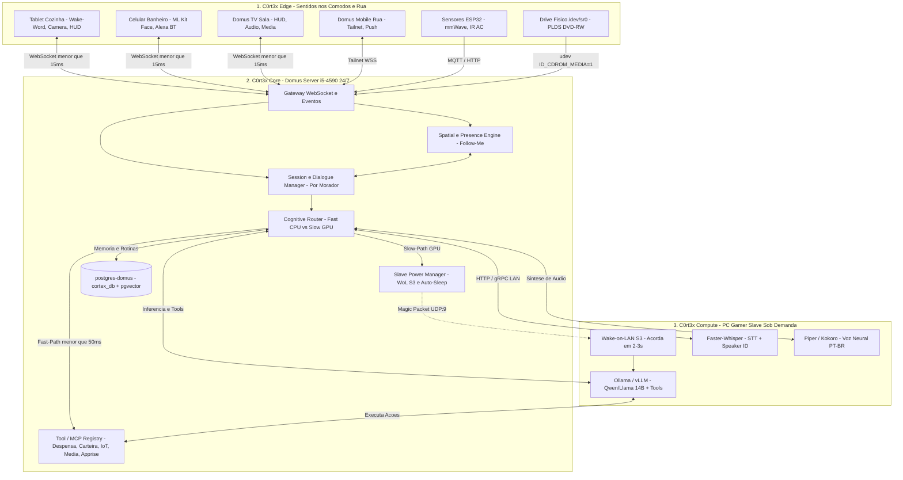
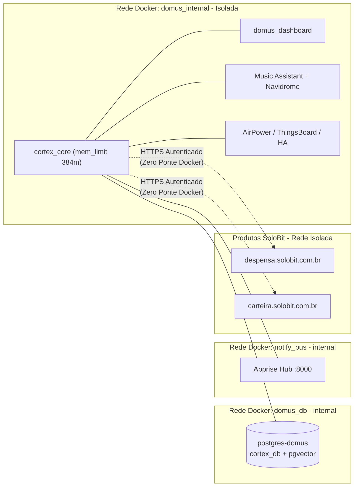

# 🏛️ Arquitetura Técnica — C0rt3x & C0rt3x Core

Este documento especifica a arquitetura completa do ecossistema **Domus C0rt3x** e do seu orquestrador central **C0rt3x Core**, projetado para operar em conjunto com o **Domus Server** (Master 24/7) e um **PC Gamer Slave** (Worker GPU sob demanda).

---

## 1. Visão Macro em 3 Camadas Físicas



### Divisão de Papéis
1. **C0rt3x Edge (Borda nos Cômodos):** Terminais Android (`domus-node-sdk`) instalados em tablets de parede, celulares antigos em modo quiosque, Smart TVs (`domus-tv`) e smartphones pessoais (`domus-mobile`), além de sensores DIY ESP32 e do drive óptico `/dev/sr0`. Executam detecção leve local (wake-word + face detection ML Kit) para evitar streaming contínuo de áudio/vídeo pela rede.
2. **C0rt3x Core (Sistema Nervoso Autônomo — 24/7):** Serviço FastAPI assíncrono no Domus Server (`Intel Core i5-4590`, `mem_limit: 384m`). Mantém estado da casa, sessão por usuário, roteamento espacial *Follow-Me*, memória e execução de ferramentas.
3. **C0rt3x Compute (Worker GPU Sob Demanda):** PC Gamer na LAN permanecendo em suspensão na RAM (**S3 Sleep**, ~2–5W). Acorda em **2–3 segundos** via Wake-on-LAN quando o *Cognitive Router* aciona o *Slow-Path* (LLM, transcrição complexa ou síntese de voz), e volta a dormir após 10 minutos de inatividade (`IDLE_TIMEOUT=600s`).

---

## 2. Os 7 Módulos Internos do `C0rt3x Core`

### 2.1. `Spatial & Presence Engine` (`core/spatial_engine.py`)
Mantém o grafo topológico dos ambientes (`cozinha`, `sala`, `banheiro`, `quarto`, `rua_tailnet`) e determina o `active_output_node` ideal para cada morador por fusão de sinais com decaimento temporal (TTL):

| Sinal | Origem | Peso Inicial | Janela de Validade (TTL) |
| :--- | :--- | :---: | :--- |
| Voz capturada com SNR alto | Microfone do Node | `100` | Imediato (troca instantânea) |
| Rosto detectado diante do aparelho | Câmera frontal (ML Kit no Android) | `80` | `30s` |
| Presença por radar | Sensor ESP32 mmWave (`LD2410`) | `50` | `60s` |
| Transição Wi-Fi → Tailscale | `domus-mobile` no telefone pessoal | `100` (`rua_tailnet`) | Contínuo até retorno ao Wi-Fi |

### 2.2. `Session & Dialogue Manager` (`core/session_manager.py`)
- Indexa conversas por pessoa (`session:{user_id}`), nunca pelo aparelho de entrada.
- **Handoff na entrega:** Antes de enviar o áudio/HUD de resposta, consulta `SpatialEngine.get_best_output_node(user_id)`. Se o morador andou da cozinha para o banheiro durante o processamento, a resposta é entregue no banheiro com um evento prévio `CORTEX_HANDOFF_IN`.
- **Continuidade sem Wake-Word (`expect_reply_seconds`):** Perguntas proativas ou conversas abertas instruem o node destino a abrir o microfone automaticamente por `N` segundos após o fim do áudio TTS.

### 2.3. `Cognitive Router` (`core/cognitive_router.py`)
Opera em duas velocidades para reduzir latência percebida e consumo de energia:
- **Fast-Path (`<50ms` na CPU do Domus):** Matcher determinístico de intenções diretas (luzes, ar-condicionado via ESP32 IR, pause/play, volume, seleção de faixa de CD). Executa diretamente no `Tool Registry` sem acordar o PC Gamer.
- **Slow-Path (GPU do PC Gamer Slave):** Perguntas abertas, geração de receitas cruzando estoque da despensa, análise de gastos da carteira, resumo de rotina e diálogos longos. Acorda o Slave se necessário e orquestra o loop *LLM + Tool Calling + RAG*.

### 2.4. `Slave Power & Compute Orchestrator` (`core/slave_power.py`)
Máquina de estados do Worker GPU:
```text
SLEEPING_S3 ──(WoL Magic Packet UDP:9)──▶ WAKING_WOL (2-3s) ──▶ ONLINE_IDLE ◀──▶ BUSY_INFERENCE
     ▲                                                                 │
     └───────────────(HTTP POST /system/sleep após 600s ociosos)───────┘
```
Enquanto o Slave sai de `SLEEPING_S3` para `ONLINE_IDLE`, o Core envia `PLAY_SOUND` (`cortex_thinking_chime`) ao node ativo para dar feedback instantâneo ao morador.

### 2.5. `Tool / MCP Registry` (`tools/*.py`)
O modelo LLM nunca acessa bancos de dados ou sockets diretamente; ele invoca ferramentas tipadas executadas pelo `C0rt3x Core`:

| Ferramenta | Alvo & Transporte | Função |
| :--- | :--- | :--- |
| `despensa.*` | HTTPS `https://despensa.solobit.com.br` (Token de Serviço) | Consultar estoque, vencimentos próximos, sugerir receitas e incluir itens na lista de compras. |
| `carteira.*` | HTTPS `https://carteira.solobit.com.br` (Token de Serviço) | Consultar gastos do mês, faturas abertas e lançar despesas rápidas. |
| `home.iot.*` | Rede `domus_internal` (`AirPower`, `ThingsBoard`, `Mosquitto/HA`) | Acionar lâmpadas, enviar IR para ar-condicionado, ler sensores de temperatura/energia. |
| `media.*` | Rede `domus_internal` (`Music Assistant`, `Navidrome`, `/dev/sr0`) | Reproduzir músicas em zonas específicas (`quarto`, `sala`, `todos`), gerenciar filas e drive óptico. |
| `notify.*` | Rede `notify_bus` (`POST http://apprise:8000/notify/apprise`) | Enviar notificações Telegram (`tag=admin`) ou E-mail HTML quando o morador estiver fora de casa. |

### 2.6. `Memory Engine` (`core/memory_engine.py`)
Implementada em 3 camadas no cluster `postgres-domus` (`cortex_db` com extensão `pgvector`):
1. **Working Memory (RAM):** Estado corrente dos cômodos, mídia tocando e últimas 10 trocas da sessão ativa.
2. **Episodic Events (SQL):** Log estruturado com timestamp de eventos físicos e comandos relevantes.
3. **Semantic Memories (`pgvector`):** Preferências e hábitos aprendidos sobre os moradores recuperados por similaridade vetorial (Top-K=5) para compor o contexto dinâmico do LLM.

### 2.7. `Proactive Engine & Optical Watcher` (`watchers/optical_drive.py`)
Especificado em detalhes em [`OPTICAL_MULTIROOM_SPEC.md`](./OPTICAL_MULTIROOM_SPEC.md). Escuta eventos `udev` do kernel em `/dev/sr0` para iniciar interações proativas no momento em que uma mídia física é inserida.

---

## 3. Isolamento "Dois Mundos" e Redes Docker

O container `cortex_core` respeita estritamente a separação arquitetural entre **Domus** (casa/privado) e **SoloBit** (produtos):



- **Nenhuma ponte direta para `solobit_apps` ou `solobit_db`:** As integrações com Despensa e Carteira trafegam via API REST HTTPS com token dedicado, preservando a blindagem da rede doméstica.
- **Orçamento de Memória no Domus (`7.2 GiB` físicos):** O `cortex_core` consome até `384 MiB`, mantendo mais de `3.5 GiB` livres no servidor mesmo com toda a plataforma core e mídia operando juntas.

---

## 4. Estrutura Canônica do Stack no Servidor

```text
/srv/domus/infra/domus/cortex/
├── compose.yaml                  # Container cortex_core (mem_limit: 384m, device /dev/sr0:r)
├── .env.example                  # SLAVE_MAC, SLAVE_HOST, DB_URI, API_TOKENS
├── Dockerfile
├── requirements.txt
└── app/
    ├── main.py                   # FastAPI + WebSocket Gateway + Startup Hooks
    ├── core/
    │   ├── spatial_engine.py
    │   ├── session_manager.py
    │   ├── cognitive_router.py
    │   ├── slave_power.py
    │   └── memory_engine.py
    ├── watchers/
    │   └── optical_drive.py
    └── tools/
        ├── despensa_tool.py
        ├── carteira_tool.py
        ├── media_tool.py
        ├── iot_tool.py
        └── notify_tool.py
```
