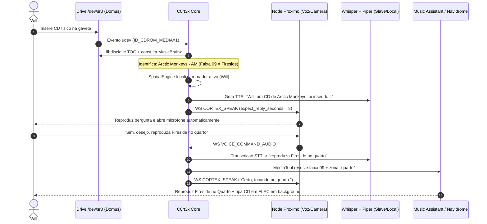

# 💿 Especificação: Drive Óptico (`/dev/sr0`), Proatividade & Áudio Multi-Room

Este documento detalha o fluxo completo de automação física e musical do **Domus C0rt3x**, utilizando o leitor de CD/DVD físico presente no servidor (`PLDS DVD+/-RW DS-8ABSH` mapeado em `/dev/sr0`).

---

## 1. Diagrama de Sequência Completo

---

## 2. Etapas Técnicas do Pipeline

### Etapa 1 — Detecção sem Polling (`pyudev`)
O container `cortex_core` recebe acesso somente leitura ao dispositivo óptico do host (`devices: ["/dev/sr0:/dev/sr0:r"]`). O módulo `watchers/optical_drive.py` usa `pyudev.Monitor` para capturar o evento de kernel no exato instante em que a gaveta fecha (`ID_CDROM_MEDIA=1`), diferenciando:
- CD de Áudio (`ID_CDROM_MEDIA_TRACK_COUNT_AUDIO > 0`)
- DVD de Dados / Filme (`ID_CDROM_MEDIA_DVD=1`)

### Etapa 2 — Identificação por TOC (`libdiscid` + MusicBrainz)
Em menos de **2 segundos**, `libdiscid` lê a Tabela de Conteúdo (TOC) do disco e calcula o **DiscID** criptográfico. O C0rt3x Core consulta a API do **MusicBrainz** (com cache local no `postgres-domus`) e obtém artista, título do álbum, ano e o mapeamento exato `track_number ↔ track_title` (ex: *Arctic Monkeys — AM*, Faixa 09 = *Fireside*).

### Etapa 3 — Abordagem Proativa Personalizada
1. O `Spatial & Presence Engine` identifica quem está presente no ambiente mais próximo ao servidor (via câmera ML Kit ou presença recente).
2. O `Proactive Engine` sintetiza o anúncio via **Piper TTS**:  
   *"Will, um CD de Arctic Monkeys foi inserido. Deseja reproduzir a mídia?"*
3. O frame `CORTEX_SPEAK` é enviado com `"expect_reply_seconds": 8`, fazendo o node abrir o microfone automaticamente ao fim da frase.

### Etapa 4 — Resolução de Faixa e Zona
Ao ouvir *"Sim, desejo, reproduza Fireside no quarto"*, o `Cognitive Router` (ou `Media Tool`) usa o contexto da sessão recém-aberta para:
1. Mapear `"Fireside"` → Faixa `09` do álbum `AM`.
2. Mapear `"quarto"` → Zona de reprodução `quarto` no **Music Assistant / Snapcast**.
3. Confirmar ao usuário: *"Certo, tocando no quarto."*

### Etapa 5 — Streaming Imediato + Auto-Ripping FLAC
Reproduzir áudio diretamente de um leitor mecânico o tempo todo gera ruído, desgaste e atrasos ao pular faixas. Por isso o pipeline adota uma estratégia híbrida:
1. **Reprodução Imediata:** Inicia o stream da faixa pedida imediatamente (ou diretamente do cache caso o DiscID já tenha sido ripado antes).
2. **Ripping Silencioso em Background:** Um worker assíncrono (`cdparanoia` + `flac` + tags do MusicBrainz) copia o álbum para `/srv/domus/docker/domus/media/music/<Artista>/<Álbum>/`, indexando-o no **Navidrome** (`mem_limit: 64m`). Das próximas vezes, qualquer faixa desse álbum inicia instantaneamente via rede ou comando de voz, mesmo sem o CD na gaveta.
